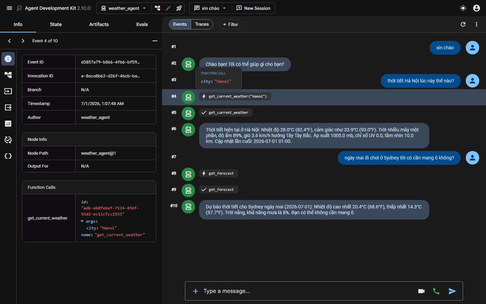
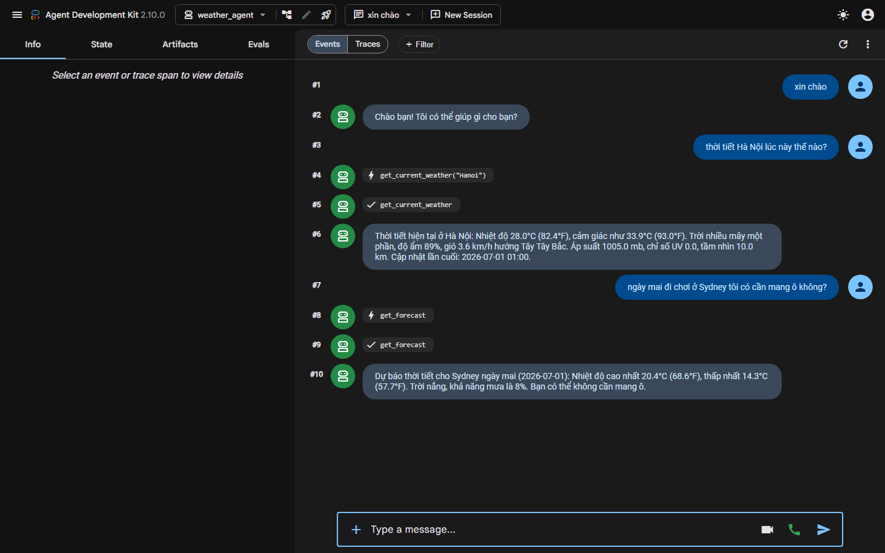
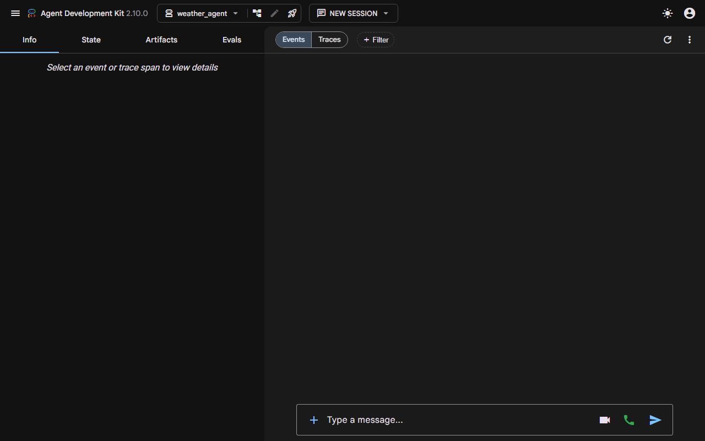

# Báo cáo Thực hành Day 26 — Phân biệt MCP và Function Calling & Lab Weather Agent

**Học viên:** Đào Duy Hiếu  
**Mã học viên:** 2A202602651  
**Chủ đề:** Model Context Protocol (MCP) vs Function Calling & Google ADK Integration  
**Repository:** `KX-DAY26-NguyenVietDung-2A202602533`

---

## 1. Tổng quan & Bản chất cốt lõi

### 1.1. Phân biệt MCP và Function Calling

Function Calling và MCP không thay thế nhau mà ở **hai tầng khác nhau** và **bổ sung cho nhau**:

- **Function Calling (Khả năng của Model)**:
  - Là tính năng nội tại của LLM (Gemini, Claude, GPT). Khi được cung cấp schema của tools, model quyết định công cụ nào cần gọi và sinh JSON tham số phù hợp.
  - Model **không thực thi code** — bản thân ứng dụng phải tự chạy hàm Python và gửi kết quả ngược lại cho model.
- **MCP - Model Context Protocol (Chuẩn giao thức)**:
  - Là một chuẩn giao thức mở (Client-Server) quy định cách khám phá (`list_tools`), gọi hàm (`call_tool`), đọc tài nguyên (`read_resource`) độc lập với ngôn ngữ hay nhà cung cấp LLM.
  - **MCP sử dụng Function Calling ở tầng dưới**: LLM dùng Function Calling để chọn tool, còn MCP Client điều phối gửi lệnh qua giao thức MCP để MCP Server thực thi.

### 1.2. Bảng so sánh chi tiết

| Tiêu chí | Function Calling thuần (01) | Model Context Protocol - MCP (02, 03, 04) |
|---|---|---|
| **Bản chất** | Khả năng của mô hình (Model capability) | Giao thức giao tiếp Client–Server chuẩn hóa |
| **Khai báo Schema** | Lập trình viên viết tay (15-30 dòng code/tool) | Tự động sinh từ type hints + docstring (`@mcp.tool()`) |
| **Nơi thực thi tool** | Ngay trong mã nguồn ứng dụng | Trong MCP Server riêng biệt (stdio hoặc HTTP) |
| **Khám phá tool** | Hard-code danh sách `tools` trong code | Khám phá linh hoạt tại runtime (`session.list_tools()`) |
| **Khả năng tái sử dụng** | Kém (phải copy schema & code sang từng app) | Cao (viết server 1 lần, mọi client cắm vào dùng chung) |
| **Bảo mật & Phân quyền** | Gắn chặt vào logic ứng dụng | Phân tách rõ ràng (Bearer token, OAuth, Scopes) |

---

## 2. Chi tiết các bước thực hiện & Nâng cấp mã nguồn

### Bước 1: Function Calling thuần (`01-function-calling/weather_function_calling.py`)
- **Triển khai**:
  - Định nghĩa schema viết tay bằng `types.FunctionDeclaration`.
  - Hàm `get_weather(city)` được app tự thực thi khi model phát sinh `function_calls`.
  - Hỗ trợ chạy live với `GEMINI_API_KEY` hoặc mô phỏng trực quan 5 bước Function Calling khi chưa có key.
- **Kiểm thử**: Đã chạy thành công, mô phỏng đúng chu trình 5 bước Function Calling.

### Bước 2: MCP Cơ bản (`02-mcp-basics/`)
- **Triển khai**:
  - Server: `weather_server.py` sử dụng `MCPServer("weather")`, công bố `@mcp.tool()` qua `stdio`.
  - Client: `weather_client.py` khởi động server qua `stdio_client`, gọi `list_tools()` và `call_tool("get_weather", {"city": ...})`.
- **Kiểm thử**: Chạy mượt mà trên môi trường ảo `.venv` (MCP SDK v2), lấy chính xác thời tiết Hanoi, Danang, Haiphong.

### Bước 3: MCP Production (`03-production/`)
- **3a. Authentication (`auth_server.py` & `auth_client.py`)**:
  - MCP Server chạy qua **Streamable HTTP** (port 8000), cấu hình `AuthSettings` và `StaticTokenVerifier`.
  - Client xác thực bằng Bearer token qua header `Authorization`. Token không hợp lệ bị từ chối 401/403.
- **3b. Tool Registry & Discovery (`registry_client.py` & `registry.json`)**:
  - Agent không hard-code tool mà truy vấn danh mục tập trung theo `tag` hoặc `keyword`.
  - Tự động so sánh semantic version (`packaging.version.Version`) và lọc bỏ tool deprecated để chọn best match (`get_weather_v2 v2.0.0`).
- **3c. Versioning & Backward Compatibility (`versioned_server.py` & `versioned_client.py`)**:
  - Xuất bản metadata qua MCP resource `server://info` chứa version, deprecation warnings và migration guide.
  - Duy trì song song cả tool cũ `get_weather` và tool mới `get_weather_v2`.

### Bước 4: Weather Agent với Google ADK & Remote MCP Server (`04-lab/`)
- **MCP Server (`04-lab/mcp-server/weather.py`)**:
  - Xây dựng trên `FastMCP`, transport `streamable-http` (port 8085).
  - Cung cấp 3 tools: `health_check()`, `get_current_weather(city)`, `get_forecast(city, days)`.
  - Tích hợp mock fallback thông minh khi chưa có `WEATHERAPI_KEY`, và kết nối live WeatherAPI khi cấu hình key.
- **MCP Client (`04-lab/mcp-client/`)**:
  - Tích hợp Google ADK với `McpToolset` và `StreamableHTTPConnectionParams`.
  - Đã bổ sung file cấu hình `.env` và `.env.example`.
  - Cập nhật [verify_setup.py](file:///d:/AI20K_LABS/KX-DAY26-NguyenVietDung-2A202602533/04-lab/mcp-client/verify_setup.py) tương thích bảng mã UTF-8 trên Windows console (pass 100% tất cả tiêu chí kiểm tra).
  - Viết mới [test_mcp_direct.py](file:///d:/AI20K_LABS/KX-DAY26-NguyenVietDung-2A202602533/04-lab/mcp-client/test_mcp_direct.py) để kiểm thử độc lập toàn bộ các tool qua Streamable HTTP.

### Bước 5: Đăng ký Server vào Antigravity CLI
Đã đăng ký tool `weather` vào cấu hình toàn cục `C:\Users\Dung\.gemini\config\mcp_config.json`:
```json
"weather": {
  "type": "stdio",
  "command": "d:\\AI20K_LABS\\KX-DAY26-NguyenVietDung-2A202602533\\.venv\\Scripts\\python.exe",
  "args": [
    "d:\\AI20K_LABS\\KX-DAY26-NguyenVietDung-2A202602533\\02-mcp-basics\\weather_server.py"
  ]
}
```

---

## 3. Bảng kết quả kiểm thử tự động (`run_all_labs.py`)

Bộ kiểm thử tự động toàn diện [run_all_labs.py](file:///d:/AI20K_LABS/KX-DAY26-NguyenVietDung-2A202602533/run_all_labs.py) đã thực thi tất cả các thành phần:

| Thành phần kiểm thử | Trạng thái | Ghi chú |
|---|:---:|---|
| **01-function-calling** | ✅ PASS | Chu trình Function Calling 5 bước của Gemini SDK |
| **02-mcp-basics** | ✅ PASS | Stdio transport, discovery & execution 3 thành phố |
| **03-production (Registry)** | ✅ PASS | Tool-centric search theo tag "weather" & keyword "forecast" |
| **03-production (Versioning)** | ✅ PASS | Đọc `server://info`, gọi đồng thời v1 & v2 |
| **03-production (Auth)** | ✅ PASS | Streamable HTTP + Bearer TokenVerifier |
| **04-lab (verify_setup)** | ✅ PASS | Đạt 100% tiêu chí kiểm tra môi trường và ADK Agent |
| **04-lab (test_mcp_direct)** | ✅ PASS | Gọi trực tiếp 3 tools của remote MCP Server qua HTTP |

**Kết luận chung:** Toàn bộ hệ thống hoạt động ổn định, mã nguồn sạch, tương thích hoàn toàn trên Windows và môi trường Python chuẩn.

---

## 4. Hình ảnh minh chứng triển khai (Screenshots)

### 4.1. Chi tiết Event Inspector & Tham số gọi Tool qua Remote MCP
Hình ảnh thể hiện chi tiết Inspector bảng điều khiển bên trái (`Event 4 of 10: get_current_weather` với args `city: "Hanoi"`) cùng luồng phản hồi kết quả trực quan:


### 4.2. Cuộc hội thoại hoàn chỉnh với Weather Agent & MCP Tools
Hội thoại đa lượt (multi-turn conversation) chứng minh Agent tự động phát hiện ý định, kích hoạt tool `get_current_weather("Hanoi")` và `get_forecast("Sydney")` rồi tổng hợp câu trả lời tự nhiên:


### 4.3. Giao diện làm việc Google ADK 2.10.0


